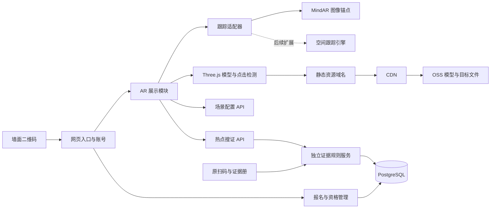

# 墙面、纸张与现场空间 Web AR 搜证系统

当前默认 `/ar` 已采用二维码四角直接估计姿态并持续锚定，详见 [QR-TRACKING.md](QR-TRACKING.md)。下文保留定位海报方案的历史评估，对应 `/ar/:sceneId` 独立场景；默认扫码不要求另外打印海报或编译 `.mind`。

评估日期：2026-10-13。实施更新：已接入图像跟踪、GLB、点击搜证及打印海报，操作见 [AR操作说明](AR-OPERATIONS.md)。需求：扫描墙上二维码打开网页；网页授权摄像头后，持续识别墙面定位图；3D 模型相对墙面固定，用户移动手机时透视随之改变；点击模型中的搜证位置，证据进入个人证据册。纸质线索页使用同一套能力。房间搜证按区域部署锚点，进一步扩展空间跟踪。

## 技术结论

首版选择 **React + Three.js + MindAR 图像跟踪 + 现有 Express/PostgreSQL + GLB + OSS/CDN**。这是基于当前需求的工程建议，尚未经过现场手机性能测量。

二维码负责进入地址，识别图负责空间定位。推荐把二维码印在有丰富纹理的固定海报中，二维码与周围图案一并定稿、编译成 `.mind`。二维码内容或海报排版变化后需要重新编译并测试。纯二维码重复纹理较多，能否稳定作为自然图像目标必须实测，不能把现有 jsQR 解码能力等同于 AR 姿态跟踪。[MindAR 图像目标编译说明](https://hiukim.github.io/mind-ar-js-doc/quick-start/compile/)

MindAR 提供摄像头图像目标跟踪及 Three.js 锚点集成；识别得到的锚点可以承载模型与热点。点击可以用 Three.js Raycaster 实现，证据判断继续由业务服务器处理。[Three.js 图像跟踪示例](https://hiukim.github.io/mind-ar-js-doc/more-examples/threejs-image/)、[交互与跟踪事件](https://hiukim.github.io/mind-ar-js-doc/examples/events-handling/)

**模型固定在墙上，不是跟随手机移动。** 用户靠近、侧移或转动手机时，渲染器用更新后的锚点姿态重新投影模型。墙面锚点失去跟踪时应暂停点击并隐藏模型、提示重新对准；不能沿用旧屏幕坐标假装仍有定位。

## 三种定位能力及边界

| 场景 | 实现 | 能做到 | 边界 |
| --- | --- | --- | --- |
| 纸质线索页 | 图像目标 + 页面局部坐标 | 模型贴合页面；纸张移动时模型一起移动 | 需要目标可识别；反光、弯曲、遮挡会影响跟踪 |
| 墙面模型 | 固定海报目标 + 墙面局部坐标 | 手机移动时模型仍固定在墙面附近；可点证物 | 锚点离开镜头后不保证持续定位 |
| 房间/桌面搜证 | 每区域固定识别图 + 实测热点坐标 | 在可见锚点周边叠加柜子、桌面证物及热点 | 不是全房间 SLAM；大范围移动会降低可用性 |
| 离开识别图后仍保持位置 | 空间跟踪、空间锚点、现场配准 | 在空间跟踪有效时继续保持位置 | 需另选并验证支持目标手机的引擎，且处理漂移、重新定位 |

普通 WebXR 的平面 hit-test 只帮助把物体放到检测到的表面，不会自动识别“这面墙就是书房墙”或“这里就是某个真实抽屉”。仍需识别图、人工配准或空间地图，把剧情坐标系与现场坐标系对应起来。

WebXR 能力必须运行时检测 `navigator.xr?.isSessionSupported('immersive-ar')`；会话支持也不代表所有 anchors/hit-test 特性都支持。不能将纯 WebXR 作为所有手机及微信内置浏览器的唯一入口。[MDN 能力检测与兼容性](https://developer.mozilla.org/en-US/docs/Web/API/XRSystem/isSessionSupported)

如果验收要求用户转身、走到墙外仍持续定位，则第二阶段要评估提供 Web 空间跟踪的 SDK；若目标浏览器无法满足稳定性，则需评估原生 ARKit/ARCore 容器。该决策取决于实际设备矩阵和 SDK 当前支持、授权条件，不能用首版图像跟踪承诺。

## 解耦结构



采用模块化单体，当前40人单场活动无需拆成多个微服务。代码边界先分清，减少部署、鉴权和跨服务事务负担。

| 模块 | 职责 | 不应承担 |
| --- | --- | --- |
| 报名与身份 | 账号、票务、签到、角色审批 | 摄像头、模型加载、坐标处理 |
| 活动规则 | 幕数、调查组、鉴定、运营放行 | 依赖某个 AR SDK |
| 证据领域 | 获取证据、权限检查、重复点击幂等、证据册 | 判断模型如何渲染 |
| 场景配置 | 识别目标、模型变换、热点与证据映射 | 内嵌证据正文、授予金币 |
| 跟踪适配器 | 启停摄像头、锚点姿态、找到/丢失目标事件 | 写数据库或发奖励 |
| 展示与交互 | 加载模型、动画、射线点击、状态提示 | 自行决定证据是否开放 |
| 资源层 | 对象键转访问地址、缓存、后续签名 | 记录玩家是否已搜证 |

前端后续建议目录为 `src/features/ar/{ArPage,scene-client,tracking,image-tracker,renderer,asset-loader}`。跟踪接口围绕 `start/stop/onAnchorFound/onAnchorUpdated/onAnchorLost`，由适配器提供相机投影及锚点变换。Three.js 渲染循环独立运行，React 只管理界面状态，避免每帧通过 React 更新姿态。

新增 `/ar/:sceneId` 路由，登录时保留目标场景；不能简单复用当前 `/play?clue=`，否则现有登录跳转会丢失 AR 场景。AR 页面按需加载跟踪与渲染依赖，报名首页不加载 AR 引擎。

## 墙面坐标与现场标定

识别图中心作为原点，X 向图像右侧、Y 向图像上方、Z 朝图像正面。首版场景统一使用 `image-width`：整张识别图宽度为1，旋转为弧度。

例如墙面识别图实际宽30厘米：距离图中心向右60厘米、向下30厘米、向墙外15厘米的位置，在配置中为 `[2, -1, 0.5]`。该换算是假设实际打印尺寸正确、目标平整且与现场标定位置一致，不代表无需实测即可厘米级准确。

GLB 制作统一以米为单位，并在导出时应用变换。运行时把米制模型放进比例为 `1 / physicalWidthMeters` 的父节点，再应用模型自身 `scale`；模型的位置与热点位置已经是 `image-width`，不能再对它们重复换算。热点应与模型使用同一场景根节点，动画部件的热点需绑定对应节点。

房间先按书房、实验台等拆成局部区域。每区测量识别图位置、尺寸、真实道具相对距离，记录模型原点、朝向和可点击部位。换海报、换打印尺寸、移动家具都需要重新标定。区域之间共享世界坐标需要额外的坐标转换和空间跟踪支持，目前接口没有实现。

图像跟踪不自动提供真实环境深度遮挡；“虚拟证物被真实桌子正确遮住”需要手工遮挡几何或可用的深度能力。首版可先提供视觉叠加和热点点击，不能承诺完整真实遮挡。

## 点击搜证链路

1. 扫码进入 AR 场景，登录并检查票务、签到、角色审批和幕数。
2. 玩家明确点击“开启摄像头”；加载场景及当前区域资源，摄像头图像在设备上参与跟踪。
3. 找到识别图后，把模型、热点放到同一个锚点下。暂停、切后台、离开页面时停止相机并释放渲染资源。
4. 根据画布实际边界把点击转成标准化设备坐标，Raycaster 只检测当前跟踪有效的热点，不把普通界面按钮点击传入模型。
5. 点击抽屉可先播放打开动画；命中证据热点后提交场景ID、热点ID，服务器从配置查出对应证据。
6. 服务器复核资格及幕数，复用原证据服务写入 `unlocks`；重复点击返回同一证据，不重复领奖。模型上的视觉变化仅在服务器确认成功后执行。

浏览器“识别到了墙面”的事件可以被客户端伪造。当前方案沿用原扫码搜证的信任级别，不提供到场的密码学证明；若未来需要更严格的现场控制，可加签到资格、GM临时放行、动态现场口令，但仍不能把前端姿态数据当成可信证明。

## 模型如何存储，怎样更快

推荐 **OSS 存储原件和发布资源，CDN 分发发布资源，PostgreSQL 只存资源元数据和业务状态**。OSS 与 CDN 是配合关系，不是二选一；CDN 缓存命中可就近服务，首次未命中仍需回源，活动前可预热。[OSS/CDN 配置](https://www.alibabacloud.com/help/en/oss/user-guide/cdn-acceleration)、[CDN 缓存及预热说明](https://www.alibabacloud.com/help/en/cdn/use-cases/cdn-acceleration-oss-faq)

| 方式 | 适用 | 取舍 |
| --- | --- | --- |
| 应用服务器直接存模型 | 本地开发或少量演示 | 方便，但与发布耦合；带宽和磁盘由应用承担 |
| OSS 直接访问 | 小流量原型、速度实测已达标 | 部署简单；体验受地域和访问网络影响 |
| OSS + CDN | 正式现场，多人同时进入、多区域资源 | 推荐；需要缓存、跨域与回源配置 |
| 数据库二进制 | 不推荐作为模型下载链路 | 增加数据库负担、备份体积，不利静态分发 |

不能仅凭存储供应商判断谁更快。体验包括 DNS/TLS、下载、模型解码、贴图转码、GPU上传、图像目标初始化和首次跟踪。应对比实机 P50/P95 冷启动与热启动，分别记录资源大小、CDN命中、手机型号与网络。

建议发布格式 GLB，减少模型依赖文件与请求数量；几何按实测选 Meshopt 或 Draco，贴图考虑 KTX2/Basis，渲染器须配对应解码器。压缩文件小不等于解码更快，尤其要测低端手机。[Three.js GLTFLoader](https://threejs.org/docs/pages/GLTFLoader.html)、[Khronos glTF 与 KTX2](https://www.khronos.org/gltf/)

首轮优化预算（是目标，不是测速结果）：每区首屏资源尽量3–5MB，优先1K贴图、低面数和少材质，避免整栋房间一次性加载；先加载识别目标和低精度模型，再按区域加载高清模型。以弱网首个可交互画面和持续30FPS为验证目标，再根据设备实测调整。

生产资源配置：

- 使用独立 HTTPS 资源域名，运营上传原件与移动端发布版本分开目录，应用无需代理大文件下载。
- 发布对象名带内容哈希，如 `models/cabinet.<hash>.glb`、`targets/wall.<hash>.mind`；不覆盖旧发布文件。静态发布对象可设长缓存 `Cache-Control: public, max-age=31536000, immutable`。
- OSS 和 CDN 对网页域名配置 GET/HEAD CORS，检查缓存命中与回源时都返回正确响应头；解码器、WASM与运行库也应自行托管。
- 玩家证据API与个性化场景API设 `no-store`，避免将证据或鉴权响应缓存给其他玩家。
- 普通模型可公开分发，涉及未开放剧情的模型应单独资源权限控制。**API不提前下发地址并不能防止已知公开URL被访问**。
- 私有 OSS + CDN URL 鉴权需要独立实现签名解析器，控制签名有效期、缓存规则及刷新。当前代码仅支持公开/同源静态地址解析，未实现私有模型授权。

40人同时下载5MB约为200MB总下载量；如果同一现场Wi-Fi出口拥塞，CDN仍无法消除最后一段网络瓶颈。活动前预热资源、玩家提前打开网页、分区域加载通常比单纯换存储更有用。

## 已完成的代码重构与接口

已完成搜证领域解耦、AR服务端、独立页面、MindAR图像跟踪、GLB加载、射线点击、公开体验、正式证据册联动及相机生命周期处理。定位海报和通用证物柜已提供；真实房间模型、现场标定和手机实拍仍需验收。部署状态另见操作说明和实际发布记录。

- `server/evidence/service.js`：抽离列表、读取、解锁、鉴定规则。
- `server/evidence/routes.js`：原 `/api/clues`、`/api/check` 接口保持兼容，现有报名与搜证继续运行。
- `server/ar/catalog.js`：场景验证、模型/热点坐标、资源对象键解析；支持 `page`、`wall`、`zone` 三种图像锚点用途，不支持离开图像后的空间锚点。
- `server/ar/routes.js`：读取场景及点击热点搜证；复用玩家资格、剧情幕数和证据幂等规则。
- `tests/ar.test.js`：权限、幕数、场景数据隔离、热点绑定防篡改、并发重复点击及路径验证。

新增接口：

```text
GET  /api/ar/scenes/:sceneId
POST /api/ar/scenes/:sceneId/hotspots/:hotspotId/collect
```

场景响应提供跟踪文件URL、模型URL、坐标及热点ID，不提供热点绑定的证据ID、证据正文和鉴定细节。提交的任意 `clueId` 或奖励字段都会被忽略。当前场景中的所有证据都需开放才可进入，因此不同幕数的证据应拆成不同发布场景。

配置参考 `docs/ar-scenes.example.json`，其中资源名称是示例占位，不包含真实 `.mind`/`.glb` 文件。`AR_SCENES_FILE` 指向服务器外部JSON配置；`AR_ASSET_BASE_URL` 切换同源资源目录、OSS地址或CDN域名。默认资源已放在 Vite public 目录，构建后随站点发布；自定义资源需要自行上传配置。

配置在启动时读取；改配置需要重启。服务启动默认使用内置墙面试点；自定义配置中没有相应场景时返回404。首次采用只读文件发布便于审查和回滚，后续再做后台编辑、数据库版本化与正式发布流程。当前示例和运营配置仍沿用单场活动；多活动需为证据、场景、玩家资格、唯一约束和审计引入 eventId，不能把当前实现视为多租户系统。

## 后续实施和验收

第一阶段：一面墙、一张固定识别海报、一个移动端GLB和三个热点。完成独立AR页面、图像跟踪适配器、模型加载、触屏搜证、相机生命周期和现有证据册联动。以纸页与墙面实测确认坐标和稳定性。

第二阶段：房间拆成多个区域，完成现场测量、区域标定、模型/热点编辑、版本发布、弱网加载和运营监控。确认转身离开锚点后是否仍需继续搜证；如需要，实施空间跟踪适配器和现场配准。

第三阶段：按真实业务需要拆报名、活动运营与多活动数据，而不是在AR试点前一次性迁移全部报名功能。

验收至少覆盖：iPhone Safari、Android Chrome和实际使用的微信浏览器；摄像头拒绝/撤销、切后台和重复进入；斜角、远近移动、遮挡、丢失/重新找到目标；冷/热缓存、弱网、GPU内存和帧率；未签到/未审批/未开放拒绝搜证；连点只入册一次。墙面位置误差应以现场道具大小及可点击范围制定阈值，不能先承诺通用厘米级误差。
