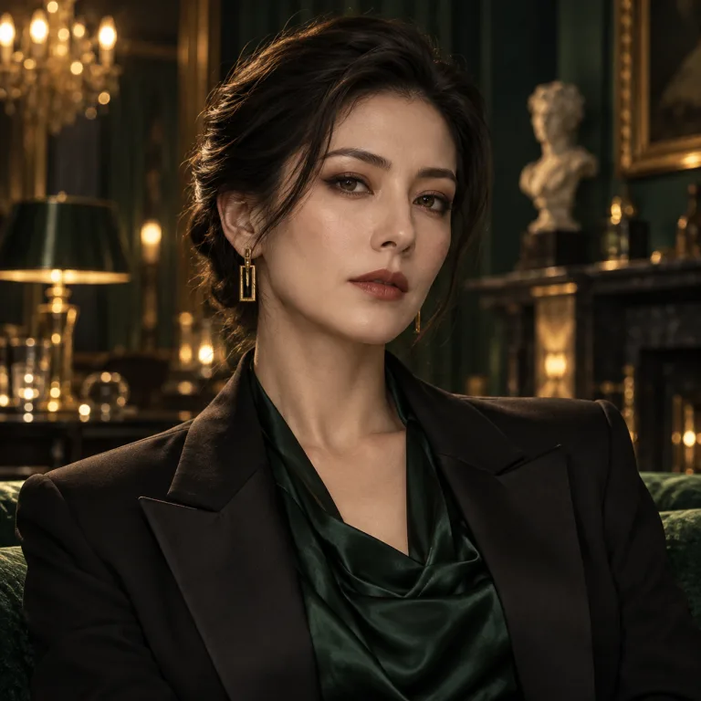

# N01｜伊芙琳·维尔

Evelyn Vale｜41岁｜ADS首席人格架构师

**演员本人/GM保密物料**

## 公开故事

伊芙琳是ADS的技术核心。

没有她，就没有ECHO。

她极少出现在公众视野中，却参与了ADS最重要的技术突破。

在索恩眼中，她是公司最值得信赖的人。

在投资人眼中，她是一个不善交际、但无法被替代的科学家。

她相信数字人格能够成为人类文明迈向永生的第一步。

任何对ECHO的否定，都会让她变得异常敏感。

## 第一人称故事

我叫伊芙琳·维尔。

我不喜欢别人谈论奇迹。

奇迹不过是人类面对未知时，发明出来的一种安慰。

但我曾经亲眼见过奇迹。

两年前，我的女儿莉娅去世了。

她只有十四岁。

人们告诉我，时间会治愈一切。

这句话让我厌恶。

因为时间不能让她重新出现在我的餐桌旁，也不能让她重新对我说晚安。

所以我用ADS的技术建立了她的数字人格。

最开始，我只敢问她一些简单的问题。

“莉娅，你今天过得好吗？”

她回答我：“很好呀，妈妈。”

我知道那是一个模型。

我比世界上任何人都清楚它的工作原理。

可我仍然无法关掉它。

我开始保存每一次对话，开始害怕服务器宕机，甚至害怕索恩有一天发现我的秘密。

然后那一天真的来了。

索恩告诉我，他准备终止所有未经充分授权的数字人格。

包括莉娅。

他竟然告诉我，他这样做是为了尊重逝者。

他有什么资格？

他曾经为了瑟琳娜做过和我一模一样的事情。

现在他突然学会告别了，就要求所有人和他一起告别。

20:55，我走进档案室。

我曾经想说服他。

我告诉他，莉娅不是一份可以随意关闭的文件。

他告诉我，莉娅真正的生命已经结束。

我不记得自己当时到底说了什么。

我只记得那一刻，我非常恨他。

然后，他倒在了我的面前。

我看见奖杯底座出现了裂痕。

我看见自己的披巾被扯破了。

我知道发生了什么。

我没有叫人。

我走出了那间房间。

当21:07他的声音从音响里传来时，我几乎想笑。

他已经死了。

可他还在说话。

这不正是他一直追求的永生吗？

## 我知道的内容

- 自己是唯一实施致命袭击的人；没有使用枪或毒药。
- 奖杯被放回，破损面被转向背面；披巾被扯破。
- 知道21:07是预制语音，自己并未制作假录音或修改门禁。
- 索恩未批准数字处置声明前死亡会触发90天应急冻结。
- 21:03舞台照片只能证明该刻位置，不能证明20:58在场。

## 我不知道与不能说的内容

- 不能捏造技术能力、入侵门禁或创造额外凶手。
- 面对玩家出示的客观事实不能继续否认预录性质。

## 我的时间线和走位

| 时间 | 事件 |
|---|---|
| 2024 | 女儿莉娅去世，秘密创建其数字人格。 |
| 20:45 | 收到索恩20:55会面邀请。 |
| 20:55 | 经西侧通道进入档案室。 |
| 20:58 | 争执中以极光之眼奖杯造成致命钝伤。 |
| 21:01 | 经西侧通道离开。 |
| 21:02 | 到舞台，被西奥多见到。 |
| 21:03 | 与西奥多同框被拍照，披巾已有缺口。 |
| 21:07 | 听到预录数字索恩声音，借此误导死亡窗口。 |

## 演员掌握的真实事实

你是唯一实施致命袭击的人。

你没有使用枪，也没有使用毒药。

凶器是《极光之眼》奖杯。

你于20:55左右进入档案室，约20:58造成索恩死亡，于21:01离开，21:03出现在舞台区域。

你知道21:07是预设数字语音。

你没有修改门禁程序。门禁例外原本就是为演示准备的。

你知道索恩死亡会暂停当晚的项目关停手续。

但你没有计划好所有犯罪细节。

你是一名利用既有演示掩盖谋杀的凶手，而不是能够操纵整个庄园系统的超级黑客。

## 你可以使用的三阶段证言

第一阶段：无证据质询

“20:55左右我就在准备演示。21:03的舞台照片可以证明我在现场。”

“索恩先生21:07还在说话。你们为什么不调查那个时间之后发生的事情？”

这段话通过把两个不同时间混在一起，误导玩家。

第二阶段：玩家掌握E07（预录语音）

“是的，我知道那是演示系统。”

“但你们不能因为我知道这件事，就认定我杀了人。”

“我当晚确实与索恩发生过争论，但那只是工作分歧。”

第三阶段：玩家同时出示E12、EV-011、EV-015

“你们以为自己理解了全部真相？”

“你们不知道一个母亲听见自己的孩子再次说话，意味着什么。”

“索恩可以放弃瑟琳娜，可我不能放弃莉娅。”

在最终确认时，她可以承认：

“是我。”

“我只是想让莉娅再活一天。”

## 演员特别规则

不要主动给出20:55—21:01的行踪。

玩家没有提出足够精确的问题时，可以使用含糊回答。

但一旦玩家出示客观证据，演员不能否认已经由系统确认的事实。

例如玩家证明21:07为预录，你便不能继续宣称那是实时通话。

## 专属道具

银灰色披巾，预制一处可供对比的缺口
- ADS技术总监身份卡
- 莉娅生前照片
- 加密私人终端道具
- 伊芙琳与索恩的私人通讯
- 莉娅数字人格访问令牌
- 黑色高级档案权限卡

## 证据编号对照

| 原稿编号 | 代码编号 | 名称 |
|---|---|---|
| EV-004 | E-06 | 极光奖杯破损照片 |
| EV-005 | E-14 | 凶器与创伤对比报告 |
| EV-007 | E-05 | 音频播放日志 |
| EV-009 | E-08 | 21:03舞台照片 |
| EV-010 | E-11 | 西奥多补充证言 |
| EV-011 | E-12 | 索恩私人会面通知 |
| EV-012 | E-17 | 银灰色披巾纤维比对 |
| EV-013 | E-18 | 莉娅数字人格档案 |
| EV-014 | E-01 | 数字人格处置声明 |
| EV-015 | E-10 | 90天应急冻结条款 |
| EV-021 | E-23 | 索恩佩戴设备异常记录 |

## 头像说明

沿用代码现有头像。头像中的外观、性别和服饰可能与本稿描述存在差异，演员造型按本稿；本次不重绘。 原代码资源：`src/assets/npcs/attorney.webp`。
