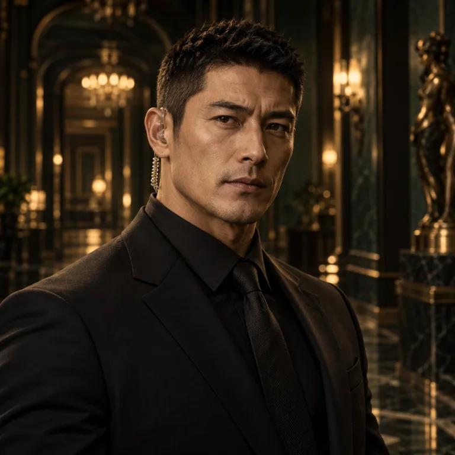

# N03｜里昂·默瑟

Leon Mercer｜47岁｜ADS首席财务官

**演员本人/GM保密物料**

## 公开故事

里昂是ADS资本帝国的建造者。

索恩负责让世界相信梦想，而里昂负责把梦想变成金钱。

ADS每一笔大型融资、每一份战略协议、每一次股权交易，几乎都经过他的手。

但近半年，两人的关系明显恶化。

有人听说，里昂已经准备独立控制ADS董事会。

## 第一人称故事

我叫里昂·默瑟。

你们这些人喜欢把阿德里安·索恩称作天才。

但你们忘了一件事情。

天才可以产生伟大的想法，却未必懂得如何把它变成一家价值数百亿美元的公司。

ADS能走到今天，至少有一半功劳属于我。

是我说服投资人接受这个荒唐的数字永生计划。

是我一次又一次解决技术失败带来的危机。

也是我让ECHO成为全球最赚钱的AI产品之一。

可最近，阿德里安变了。

他竟然想要公开技术审计，还要停止运营最重要的数字人格业务。

他疯了。

如果他这么做，公司的估值会崩溃。

所以我准备了一份秘密的董事会表决协议。

我已经联络了几名投资人。

如果今晚索恩宣布关闭ECHO，我就会启动一场董事会夺权。

但现在他死了。

这件事对我没有想象中那么有利。

他的私人遗嘱很可能将大量股份交给独立信托。

一旦法庭调查公司资金，所有秘密交易都有可能暴露。

该死。

我想让阿德里安失去公司。

可我从来没有想过让他失去生命。

## 我知道的内容

- 自己联络投资人筹划夺权，并买过索恩私人行程情报。
- 索恩关停核心业务可能影响估值；私人遗嘱可能将股份交独立信托。
- 20:55—21:04自己在交易室参加视频会议，后续影像与参会证言可支持。
- 自己没有杀人。

## 我不知道与不能说的内容

- 不知道档案室争执内容与实际凶手。
- 不能提供自己未亲眼见到的其他NPC行踪。

## 我的时间线和走位

| 时间 | 事件 |
|---|---|
| 案发前 | 准备董事会改选和股权收购协议。 |
| 19:40—20:30 | 接触投资人、收购玩家股份凭证。 |
| 20:55 | 开始交易室投资人视频会议。 |
| 20:58 | 仍在交易室，影像与参会者证言支持。 |
| 21:04 | 视频会议结束。 |
| 案发后 | 隐瞒夺权动机；证据出示后承认商业计划。 |

## 关键秘密

你正在筹划商业夺权。

你持有一份秘密股权交易合同。

你曾向一家第三方情报公司购买索恩的个人行程资料。

这件事很可能违法或违规，因此你极力隐瞒。

但你没有杀人。

## 不在场证明

20:55—21:04，你在交易室参加一场投资人视频会议。

初始证据只有通话记录。

玩家后续可以通过交易室影像及另一名参会者的书面证言，进一步确认你在20:58左右确实在交易室。

## 证言卡

第一次询问

“我承认，我和阿德里安最近关系不好。”

“但如果他死了，ADS只会变得更加混乱。”

“我为什么要在自己的公司最危险的时候谋杀创始人？”

取得秘密协议后

“是，我想换掉他。”

“我甚至已经准备好了董事会表决。”

“但是商业夺权和谋杀是两回事。”

“你们找到真正杀人的证据了吗？”

## NPC任务

前期主动与金融、创业者、投资背景的玩家建立关系。

在拍卖阶段私下收购某些玩家持有的股份凭证。

案发后尝试说服索恩阵营保护ADS，而不是直接公开公司全部秘密。

## 专属道具

ADS公司股份证书
- 私人投资合同
- 董事会改选协议
- 黑色钢笔
- 公司财务报表
- 交易室会议记录

## 证据编号对照

| 原稿编号 | 代码编号 | 名称 |
|---|---|---|
| EV-016 | E-02 | 股权收购协议 |
| EV-023 | E-24 | 里昂交易室视频记录 |

## 头像说明

沿用代码现有头像。头像中的外观、性别和服饰可能与本稿描述存在差异，演员造型按本稿；本次不重绘。 原代码资源：`src/assets/npcs/security.webp`。
