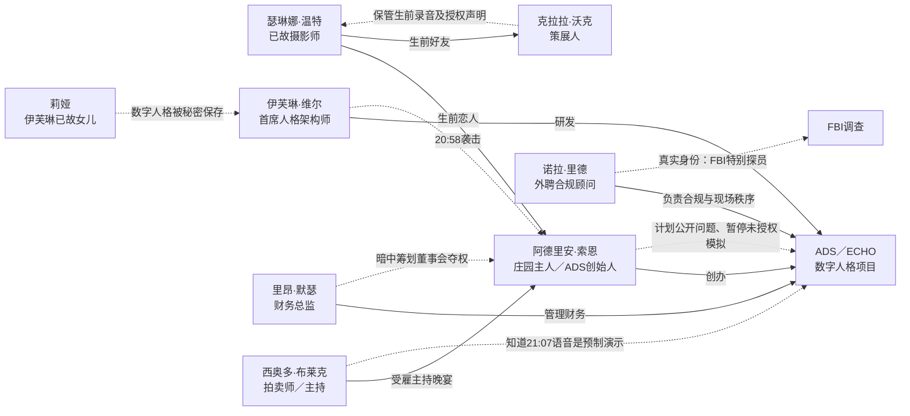

# 人物关系图谱

> **GM／导演专用，含凶手与隐藏身份。不要发给玩家。**实线是开场可说的关系；虚线是调查中逐渐揭示的秘密。玩家最初只需要记住六位在场 NPC：索恩、伊芙琳、诺拉、里昂、西奥多、克拉拉。

## 六位在场人物，用一句话记住

| 人物 | 表面身份与关系 | 秘密／为什么可疑 | 实际案件作用 |
|---|---|---|---|
| **索恩** | 庄园主人、ADS创始人；瑟琳娜的恋人 | 准备承认ECHO的问题并签署处置声明 | 死者；提前安排了21:07数字语音演示 |
| **伊芙琳** | ECHO的首席人格架构师，索恩的核心同事 | 秘密保存亡女莉娅的数字人格，害怕项目被关停 | **唯一凶手**；20:58用奖杯袭击索恩 |
| **诺拉** | 外聘安全合规顾问 | 真实身份是FBI特别探员；知道临时安全通行模式 | 案发后组织调查，说明门禁并非真正密室 |
| **里昂** | ADS财务总监，与索恩有商业分歧 | 计划董事会夺权，看起来有杀人动机 | 错误嫌疑人；20:58有交易室视频不在场证明 |
| **西奥多** | 拍卖师、晚宴主持人，受索恩雇用 | 知道21:07语音预先制作；另有非法数据交易 | 时间诡计的关键证人，也是错误嫌疑人 |
| **克拉拉** | 策展人，瑟琳娜的好友 | 保存瑟琳娜的录音和拒绝商业复制的声明 | 情感与授权线索；20:59已在摄影区 |

## 关系的核心冲突

**索恩与伊芙琳**都因失去亲人而依赖 ECHO，却在是否继续模拟上走向对立。**瑟琳娜的生前意愿**让索恩决定公开问题；**莉娅的数字人格**让伊芙琳拼命阻止。里昂的夺权计划、西奥多的数据交易、诺拉的卧底身份、克拉拉对瑟琳娜的维护，分别提供了其他可疑动机和线索，但都不改变唯一凶手。

如需在玩家面前介绍人物，只使用表格“表面身份与关系”一列；其他列及虚线关系留到调查阶段。
